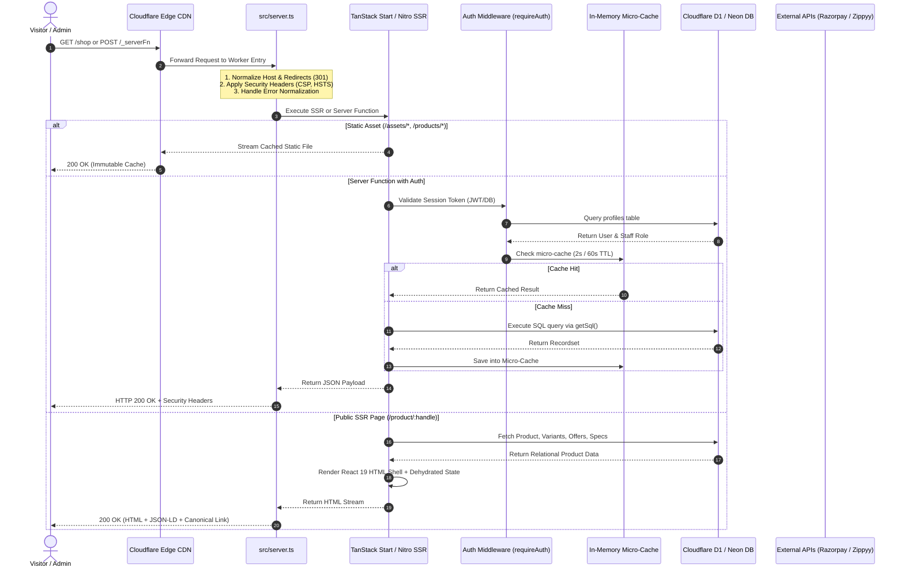

# RIOTOUS System Architecture & Dependency Map

> **Core Philosophy**: Fast Edge SSR • Type-Safe Full-Stack React • Zero-Stale Admin Sync • Lightweight Micro-Caching

This document details how requests move through the RIOTOUS application, the relationship between client and server layers, and the architectural principles governing the codebase.

---

## 1. Request Lifecycle Overview

The diagram below illustrates how an HTTP request travels from a user's browser through Cloudflare's edge network, the server runtime, middleware, and backend databases.



---

## 2. Layer-by-Layer Architectural Breakdown

### 2.1 The Edge & Worker Layer (`src/server.ts`, `wrangler.json`)
The application is compiled into a single Cloudflare Workers module bundle by Nitro 3 (`.output/server/index.mjs`).
- **Entry Point**: `src/server.ts` wraps the TanStack Start server entry (`@tanstack/react-start/server-entry`).
- **Host Normalization**: Automatically issues HTTP 301 redirects to enforce the apex domain (`www.riotous.store` -> `riotous.store`).
- **Catalog Normalization**: Legacy routes (`/products`, `/collections`, `/catalog`, `/product`) are permanently 301-redirected to `/shop`.
- **Trailing Slash Normalization**: Strips trailing slashes from URLs to avoid duplicate content penalties in Google Search.
- **Global Security Headers**:
  - `Content-Security-Policy`: Permits script execution for Razorpay Checkout (`https://checkout.razorpay.com`), Google Tag Manager, Google Fonts, and internal APIs.
  - `Strict-Transport-Security`: Enforces 1-year HSTS (`max-age=31536000; includeSubDomains`).
  - `X-Frame-Options: SAMEORIGIN`: Prevents clickjacking outside same-origin frames.
  - `X-Content-Type-Options: nosniff`: Disables MIME sniffing.
  - `Permissions-Policy`: Restricts camera, microphone, and geolocation while enabling Razorpay payment frames.
  - `X-Robots-Tag: noindex, nofollow`: Automatically attached to all administrative, account, checkout, and private API responses.

### 2.2 Client Routing & Hydration (`src/client.tsx`, `src/router.tsx`)
- **Router Setup**: Built on TanStack Router (`@tanstack/react-router`).
- **Code-Splitting**: Routes use TanStack Router's `.lazy.tsx` convention for heavy UI components (e.g. `/design`, `/admin/*`, `/checkout`).
- **Hydration**: `src/client.tsx` hydrates the SSR HTML markup, initializing client-side TanStack Query cache and Zustand state stores.
- **Client Caching**: TanStack Query handles client data fetching, while Zustand (`src/stores/cart-store.ts`) manages persistent local storage for cart items.

### 2.3 Server Functions (`createServerFn`) & Middleware
Backend operations are defined as type-safe server functions using `createServerFn` from `@tanstack/react-start`.
- **Location**: Defined inside `src/lib/*.functions.ts`.
- **Input Validation**: Strongly typed using `.inputValidator((data) => validatedData)`.
- **Authentication Guard**: Wrapped with `.middleware([requireAuth])` from `src/lib/auth-middleware.ts`.
- **Execution Mechanism**: Under the hood, TanStack Start invokes server functions via POST requests to `/_serverFn` with encrypted/hashed function identifiers.

### 2.4 Authentication & Staff RBAC
Authentication uses an unforgeable session architecture:
- **Tokens**: Stored in client `localStorage` under key `riotous_session` and mirrored into `document.cookie`.
- **Client Parsing**: `src/lib/auth.types.ts` (`parseTokenPayload`) allows optimistic client-side UI rendering without granting security privileges.
- **Server Verification**: `src/lib/auth.server.ts` cryptographically validates tokens, while `src/lib/auth-middleware.ts` performs database lookups against the `profiles` table to enforce active staff roles (`Super Admin`, `Admin`, `Manager`, `Staff`). Inactive or suspended accounts are rejected.

### 2.5 Database Abstraction & Hybrid Connectivity (`src/lib/db.ts`)
The database module is engineered to operate seamlessly across three environments:
1. **Cloudflare D1 (Production Native)**:
   - Evaluated via `env.DB` (`riotous-db`).
   - Executes native SQLite edge queries with microsecond latency.
2. **Neon PostgreSQL (Cloud / Secondary)**:
   - Evaluated via `DATABASE_URL` using `@neondatabase/serverless`.
   - Uses pooled HTTP/WebSocket connections.
3. **Local In-Memory Engine (Offline Dev Fallback)**:
   - When neither D1 binding nor `DATABASE_URL` is configured, `src/lib/db.ts` falls back to an in-memory SQL mock populated with `FALLBACK_PRODUCTS` and mock administrative profiles.

### 2.6 Real-Time Cache Sync Invariant
To satisfy the mandatory requirement that admin panel mutations immediately reflect for all users:
- **Micro-Caches**: Short TTL in-memory maps prevent denial-of-service query bursts (e.g., catalog 2s TTL, website config 60s TTL).
- **Instant Invalidation**: Every administrative mutation (product update, price change, banner edit, coupon creation) explicitly calls its invalidation function:
  ```typescript
  // Product & Catalog updates
  invalidateCatalogCache();
  // Storefront & Banner updates
  invalidatePublicWebsiteConfigCache();
  // Coupon updates
  invalidateCouponCache();
  // Image CDN updates
  invalidateImageCache();
  ```
- This ensures that guest visitors and signed-in customers receive updated data on their very next request.

---

## 3. Module Dependency Direction

To prevent circular dependencies and maintain clean boundaries:

```text
src/routes/* (Pages, Route Tree, API endpoints)
     │
     ▼
src/components/* (Storefront & Admin UI Components)
     │
     ▼
src/hooks/* & src/stores/* (Client state & React hooks)
     │
     ▼
src/lib/*.functions.ts (Server Functions & Business Logic)
     │
     ├──> src/lib/auth-middleware.ts (Authentication Middleware)
     │         │
     │         └──> src/lib/auth.server.ts (Cryptographic Verification)
     │
     ├──> src/lib/catalog.ts (Product & Catalog Logic)
     │
     ├──> src/lib/inventory.service.ts (Stock Engine)
     │
     ├──> src/lib/zippyy/* & src/lib/razorpay.server.ts (External Integrations)
     │
     ▼
src/lib/db.ts (Database Driver, D1/Neon Abstraction)
     │
     ▼
Cloudflare D1 / Neon PostgreSQL
```

### Dependency Rules:
1. `src/lib/db.ts` MUST NEVER depend on `src/routes/*` or `src/components/*`.
2. Client components in `src/components/*` MUST NOT import server-only modules (`auth.server.ts`, `razorpay.server.ts`).
3. External integrations (`zippyy/client.ts`, `razorpay.server.ts`) must encapsulate their own token caching and retry logic.
