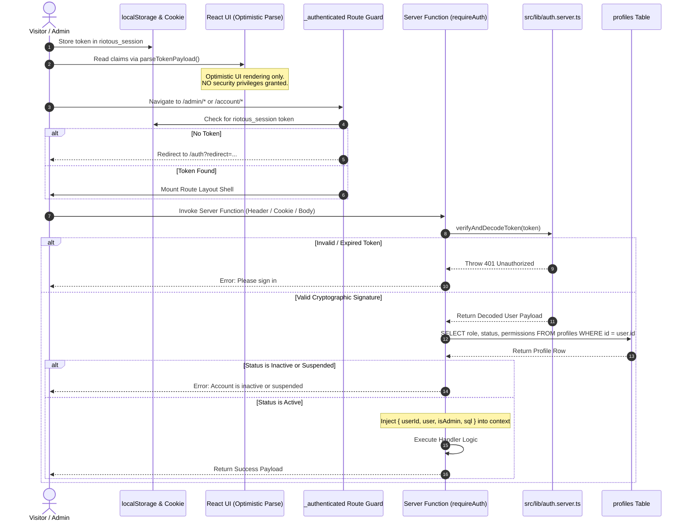

# RIOTOUS Authentication & Authorization Guide

> **Security Model**: Cryptographic Signed Tokens • Staff Role-Based Access Control (RBAC) • Database Profile Verification

This guide details the authentication flow, session storage, server middleware guards, staff roles, and permission enforcement across the RIOTOUS platform.

---

## 1. Authentication Architecture Overview



---

## 2. Session Management & Token Storage

### 2.1 Storage Mechanism
- **Primary Client Store**: `localStorage.getItem("riotous_session")`.
- **Cookie Mirroring**: Mirrored to `document.cookie` as `riotous_session=<token>; path=/; max-age=2592000; SameSite=Lax; Secure` to support server-side rendering and static asset authentication.

### 2.2 Client-Side Claims Parsing (`src/lib/auth.types.ts`)
The helper `parseTokenPayload(token: string)` extracts user metadata (ID, email, name, role) for optimistic client UI rendering (e.g. displaying "Welcome, Aarav" in the header):
> [!CAUTION]
> **Client parsing is strictly for optimistic rendering.** It does NOT grant permissions or bypass server authorization. Every protected operation is independently verified on the server.

---

## 3. Server Authentication Middleware (`src/lib/auth-middleware.ts`)

All protected server functions attach the `requireAuth` middleware. It performs a multi-stage token discovery:
1. **Context Check**: Inspects `opts.context.token` sent by client middleware.
2. **Payload Check**: Inspects `data.token` passed in arguments.
3. **HTTP Headers**: Inspects `Authorization: Bearer <token>` and `x-riotous-session`.
4. **Cookies**: Inspects `riotous_session` cookie.

### Verification & Database Validation:
1. The token is cryptographically verified using `verifyAndDecodeToken(token)` from `src/lib/auth.server.ts`.
2. The user's active status and role are queried from the `profiles` table:
   ```sql
   SELECT id, role, email, status, permissions FROM profiles
   WHERE id = $1 AND LOWER(email) = LOWER($2) LIMIT 1;
   ```
3. If `status` is `'Inactive'` or `'Suspended'`, the request is immediately rejected with `401 Unauthorized`.
4. If the profile's role matches a staff role, `isAdmin` is set to `true`.

---

## 4. Staff Roles & Role-Based Access Control (RBAC)

The application defines five standard user roles in `src/lib/auth.types.ts`:

| Role Name | Scope | Admin Panel Access? | Key Permissions |
| :--- | :--- | :--- | :--- |
| **`Super Admin`** | System Owner | Yes (`hasAdminPanelAccess: true`) | Full unrestricted access to all 19 modules, staff management, settings, and database utilities. |
| **`Admin`** | Store Administrator | Yes (`hasAdminPanelAccess: true`) | Catalog management, inventory updates, order processing, returns, coupons, and marketing. |
| **`Manager`** | Operations Manager | Yes (`hasAdminPanelAccess: true`) | Order fulfillment, inventory adjustments, and customer returns. |
| **`Staff`** | Support / Warehouse | Yes (`hasAdminPanelAccess: true`) | Order viewing, label printing, and customer support. |
| **`customer`** | Storefront Shopper | No (`hasAdminPanelAccess: false`) | Personal order history, return requests, favorites, and reviews. |

### Helper Function: `hasAdminPanelAccess`
```typescript
export function hasAdminPanelAccess(user?: { role?: string | null; status?: string | null } | null): boolean {
  if (!user) return false;
  const status = String(user.status || "Active").toLowerCase().trim();
  if (status === "inactive" || status === "suspended") return false;
  return isStaffRole(user.role);
}
```

---

## 5. Production Login Security & Brute-Force Protection

### 5.1 Distributed Rate Limiting (`src/lib/rate-limiter.server.ts`)
- **Account-Level Lockout**: Maximum **5 failed login attempts** per account within 15 minutes. Upon the 5th failed attempt, further authentication attempts for that account are blocked for **15 minutes** (returns HTTP 429).
- **IP-Level Throttling**: Maximum **20 failed attempts** per IP within 15 minutes to defend against distributed credential stuffing and automated bot assaults.
- **Persistent Distributed Storage**: State is persisted in the `rate_limits` table across Cloudflare Workers instances, backed by a memory sliding-window fallback.
- **Normalization**: Email addresses are strictly normalized (`email.trim().toLowerCase()`) before rate calculations and lookups to prevent attackers from bypassing thresholds by varying letter casing or whitespace.
- **Anti-Enumeration Generic Errors**: The login endpoint consistently returns `"Invalid email or password."` to eliminate account discovery.
- **Counter Decay & Reset**: On successful credential verification, the failed attempt counter is immediately purged via `resetPersistentRateLimit()`.

---

## 6. Password Recovery & Single-Use Cryptographic Tokens

### 6.1 Token Generation & Verification Lifecycle (`src/routes/reset-password.tsx`)
1. **Request Phase (`requestPasswordResetServerFn`)**:
   - Rate limited to 3 requests per 15 minutes per email and 10 per IP.
   - Always returns a generic confirmation: `"If an account exists for that email, password reset instructions have been sent."` whether the user exists or not.
   - Generates an unpredictable 32-byte cryptographic token (`randomBytes(32).toString('hex')`).
   - Persists only the **SHA-256 hash** (`token_hash`) in the `password_resets` table with a strict **20-minute expiration**. The plaintext token is never stored in the database or logged.
   - Generates the recovery URL using the trusted `SITE_URL` environment variable (`https://riotous.store/reset-password?token=...`), never trusting the incoming `Host` header.
2. **Consumption Phase (`resetPasswordWithTokenServerFn`)**:
   - Rate limits token verification attempts to prevent brute-force attacks.
   - Computes the SHA-256 digest of the incoming token and looks up the active record.
   - Rejects missing, expired (`expires_at < CURRENT_TIMESTAMP`), or already consumed (`used_at IS NOT NULL`) tokens.
   - Atomically updates `used_at = CURRENT_TIMESTAMP` and invalidates all other outstanding reset tokens for that user.
   - Updates `password_hash` in `profiles`, sends a security notice to the customer, and establishes a secure authenticated session.
3. **Privacy & Referrer Leakage Protection**:
   - The `/reset-password` route enforces `<meta name="referrer" content="no-referrer" />` and `<meta name="robots" content="noindex, nofollow" />` to guarantee that reset tokens are never leaked via HTTP `Referer` headers to external links or analytics.

---

## 7. Private Administrator Email Notifications

- **Recipient Privacy**: Configured strictly via server secret **`ADMIN_NOTIFICATION_EMAIL`** (e.g. via Cloudflare Worker Secrets or `.dev.vars`). Never exposed in frontend bundles, public APIs, browser storage, or client logs.
- **Transactional Delivery Provider**: Brevo API v3 (`BREVO_API_KEY`) with verified sender domain (`EMAIL_FROM`).
- **New Customer Registration Notification**: Dispatched upon successful account creation with customer name, email, user ID, timestamp, and client IP.
- **New Verified Order Notification**: Dispatched exclusively when server-side Razorpay webhook verifies payment or capture succeeds. Includes order number, customer contact, itemized sizes/variants/quantities, subtotal, shipping, and fulfillment address.
- **Idempotency Deduplication**: Employs an email deduplication cache to prevent duplicate alerts caused by Razorpay webhook retries or repeated requests.
