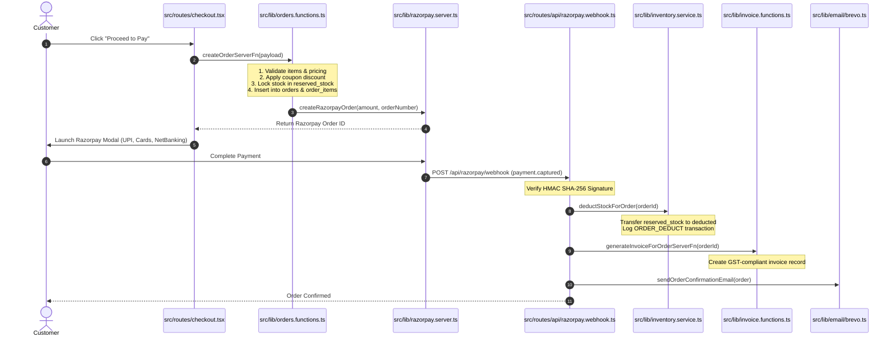

# RIOTOUS Ecommerce Workflows & Business Logic

> **Core Integrations**: Razorpay Payments • Zippyy Logistics • Brevo/Resend Transactional Email • In-Database Tax Invoicing

This document provides step-by-step guides for the end-to-end ecommerce lifecycles in the RIOTOUS codebase, detailing the files and database operations involved at each stage.

---

## 1. Product Catalog Lifecycle

```text
Admin Product Form ──> createProductServerFn ──> products & product_variants tables
                                                       │
                                                       ▼
                                            invalidateCatalogCache()
                                                       │
                                                       ▼
                                            Storefront /shop & /product/:handle
```

1. **Creation / Editing**:
   - **Interface**: `src/components/admin/product-details-editor.tsx` and `src/routes/_authenticated/admin/products.tsx`.
   - **Server Functions**: `createProductServerFn` / `updateProductServerFn` in `src/lib/admin.functions.ts`.
   - **Database Writes**: Inserts/updates `products`, `product_variants`, `product_highlights`, `product_specifications`, and `product_offers`.
   - **Instant Invalidation**: Executes `invalidateCatalogCache()` in `src/lib/catalog.ts` and `invalidateImageCache()` in `src/lib/product-images.ts`.
2. **Variant Matrix**:
   - Products specify supported sizes (`S`, `M`, `L`, `XL`, `XXL`) and colors.
   - Each variant row in `product_variants` tracks distinct `sku`, `stock_quantity`, `reserved_stock`, and `low_stock_threshold`.
3. **Archival / Deletion**:
   - Handled via `deleteProductServerFn`. Soft-deletes or removes rows and registers deleted IDs in `store_settings.deleted_product_ids` to prevent accidental re-seeding.

---

## 2. Customer Shopping Cart & Bag Operations

- **State Store**: `src/stores/cart-store.ts` (Zustand with `localStorage` persistence).
- **Compound Variant ID**: Items are keyed by `productId|size|color` (e.g. `prod_heavy_black|L|Black`).
- **Cart Drawer**: `src/components/cart-drawer.tsx` allows instant quantity adjustments, line-item removal, and promotional threshold alerts (e.g., "Add ₹301 more for Free Shipping!").
- **Server Sync**: For authenticated customers, `useCartSync()` synchronizes local bag items with the `carts` table.

---

## 3. Checkout, Payment & Order Placement



1. **Order Initiation**:
   - `createOrderServerFn` validates stock availability, calculates subtotal, shipping charge, and coupon discount.
   - Inserts row into `orders` with `status = 'Pending'` and `payment_status = 'Pending'`.
   - Locks required units by incrementing `reserved_stock` in `product_variants`.
2. **Razorpay Gateway Execution**:
   - `src/lib/razorpay.server.ts` generates a Razorpay Order ID.
   - Client launches Razorpay Checkout script with prefilled customer contact details.
3. **Verification & Stock Deduction**:
   - Client signature verification or webhook event `payment.captured` calls `deductStockForOrder()` in `src/lib/inventory.service.ts`.
   - Decrements `stock_quantity`, clears `reserved_stock`, and logs an `ORDER_DEDUCT` transaction.
   - Triggers `invalidateCatalogCache()` so live stock updates reflect across the storefront.

---

## 4. Fulfillment & Zippyy Courier Logistics

- **Integration PRD Reference**: See [docs/ZIPPYY_INTEGRATION_PRD.md](ZIPPYY_INTEGRATION_PRD.md).
- **Client & Service**: `src/lib/zippyy/client.ts` and `src/lib/zippyy/shipment.service.ts`.
- **Workflow**:
  1. Admin selects order in `/admin/orders` and clicks **Dispatch via Zippyy**.
  2. System checks pickup warehouse pincode (`ZIPPYY_PICKUP_PINCODE: 395006`) and creates shipment via Zippyy API.
  3. Zippyy assigns an Air Waybill (AWB) number and courier partner (e.g. BlueDart, Delhivery, Ekart).
  4. System updates `orders.tracking_number`, `orders.courier_name`, and inserts record in `shipments`.
  5. Webhook listener at `/api/zippyy/webhook` ingests courier tracking events, updating customer order history in real time.

---

## 5. Tax Invoices & GST Compliance

- **Functions**: `src/lib/invoice.functions.ts`, `src/routes/api/invoices.$orderId.ts`.
- **Workflow**:
  1. Once paid, `generateInvoiceForOrderServerFn` calculates taxable amount, CGST (9%), SGST (9%), or IGST (18%) depending on customer state.
  2. Generates sequential invoice number from `invoice_sequences` table (e.g. `INV-2026-0042`).
  3. Customer can view or download the invoice PDF at any time via `/account/orders` or `/api/invoices/:orderId?format=pdf`.

---

## 6. Customer Returns & Refunds

- **Interface**: Customer portal at `/account/returns` and admin console at `/admin/returns`.
- **Functions**: `src/lib/returns.functions.ts`, `src/lib/returns-shared.ts`.
- **Workflow**:
  1. Customer selects an eligible delivered order within the 7-day return window.
  2. Selects reason, attaches garment photos, and submits request into `returns` table.
  3. Admin reviews request in `/admin/returns`, updating status to `Approved` or `Rejected`.
  4. Upon physical receipt and inspection, admin triggers refund and marks status `Refunded`.
  5. System restores stock via `restoreStockForReturn()` in `src/lib/inventory.service.ts` and logs `RETURN_RESTORE`.

---

## 7. Customer Reviews & Verified Purchases

- **Files**: `src/lib/reviews.functions.ts`, `src/components/reviews/*`.
- **Workflow**:
  1. Customer submits rating (1-5 stars), text feedback, and photos at `/account/reviews` or directly on `/product/:handle`.
  2. Server queries `order_items` matching customer's user ID to automatically set `is_verified_purchase = true`.
  3. Admin reviews submissions in `/admin/reviews` with approval toggle (`is_approved = true`).

---

## 8. Custom Apparel Design Studio

- **Files**: `src/routes/design.lazy.tsx`, `src/lib/design-submissions.functions.ts`, `src/routes/_authenticated/admin/designs.tsx`.
- **Workflow**:
  1. Customer designs custom artwork on Fabric.js canvas (front and back).
  2. Submits design with contact info.
  3. JSON canvas definition and high-res preview data URLs are saved into `design_submissions`.
  4. Store operations team inspects the artwork in `/admin/designs`, coordinates printing, and contacts customer.
