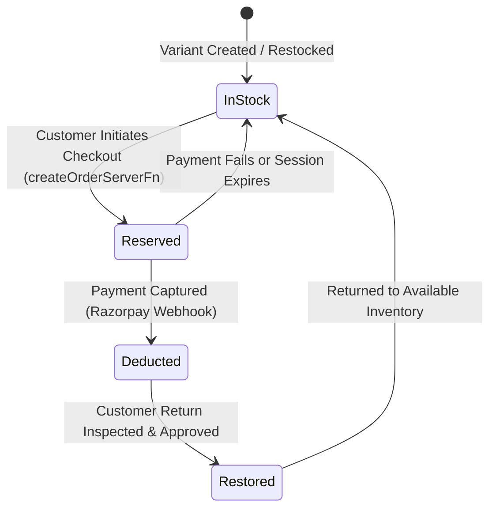

# RIOTOUS Inventory & Orders Engine

> **Service Files**: `src/lib/inventory.service.ts`, `src/lib/orders.functions.ts`  
> **Database Tables**: `products`, `product_variants`, `orders`, `order_items`, `inventory_transactions`

This document details the inventory reservation system, stock deduction lifecycle, order status state machine, and transaction audit trails in the RIOTOUS platform.

---

## 1. Inventory Architecture & Calculation

Available stock for any garment variant is calculated dynamically:
$$\text{Available Stock} = \max(0, \text{stock\_quantity} - \text{reserved\_stock})$$

- **`stock_quantity`**: Total physical inventory in the warehouse.
- **`reserved_stock`**: Units locked in pending checkout sessions to prevent overselling.
- **`low_stock_threshold`** (default `2`): Threshold below which "Low Stock: Only X left!" warning badges appear on the storefront.

---

## 2. Stock Reservation & Deduction Lifecycle



### 2.1 Step 1: Order Initiation & Stock Reservation
When `createOrderServerFn` runs in `src/lib/orders.functions.ts`:
1. It queries `product_variants` to verify that $\text{stock\_quantity} - \text{reserved\_stock} \ge \text{requested\_quantity}$.
2. If available, it locks the units:
   ```sql
   UPDATE product_variants
   SET reserved_stock = reserved_stock + $1
   WHERE id = $2;
   ```
3. Creates the order in `orders` with `status = 'Pending'` and `stock_state = 'Normal'`.

### 2.2 Step 2: Payment Confirmation & Permanent Deduction
When the payment gateway triggers `payment.captured` or client verification succeeds:
1. `deductStockForOrder(orderId)` runs in `src/lib/inventory.service.ts`:
   ```sql
   UPDATE product_variants
   SET stock_quantity = stock_quantity - $1,
       reserved_stock = GREATEST(0, reserved_stock - $1)
   WHERE id = $2;
   ```
2. Also decrements aggregate `products.stock_quantity`.
3. Records an entry in `inventory_transactions` with `change_type = 'ORDER_DEDUCT'`.
4. Updates `orders.stock_state = 'Deducted'` and calls `invalidateCatalogCache()`.

### 2.3 Step 3: Payment Failure / Expiration Release
If the customer abandons payment or the transaction fails:
1. `releaseReservedStock(orderId)` unlocks the units:
   ```sql
   UPDATE product_variants
   SET reserved_stock = GREATEST(0, reserved_stock - $1)
   WHERE id = $2;
   ```

### 2.4 Step 4: Return Stock Restoration
When an approved return is received and inspected:
1. `restoreStockForReturn(orderId, variantId, quantity)` re-credits the physical inventory:
   ```sql
   UPDATE product_variants
   SET stock_quantity = stock_quantity + $1
   WHERE id = $2;
   ```
2. Records an entry in `inventory_transactions` with `change_type = 'RETURN_RESTORE'`.
3. Calls `invalidateCatalogCache()`.

---

## 3. Order Status State Machine

Orders transition through five standard statuses:

| Status | Trigger | Inventory State | Allowed Next Actions |
| :--- | :--- | :--- | :--- |
| **`Pending`** | Order created at checkout | Reserved | Complete Payment, Cancel |
| **`Processing`** | Payment verified (`payment_status = 'Paid'`) | Deducted | Pack items, Dispatch via Zippyy |
| **`Shipped`** | Courier AWB generated & package handed to carrier | Deducted | Track shipment via Zippyy, Mark Delivered |
| **`Delivered`** | Courier marks delivered | Deducted | Initiate Return (within 7 days) |
| **`Cancelled`** | Customer cancels or payment times out | Released | Archive |

---

## 4. Inventory Transaction Audit Log

Every stock modification is permanently recorded in `inventory_transactions`:
- `id`: Unique record ID (`itx_...`).
- `product_id` & `variant_id`: Exact product and SKU modified.
- `change_type`: One of `'ORDER_DEDUCT'`, `'RESTOCK'`, `'RETURN_RESTORE'`, `'MANUAL_ADJUST'`.
- `quantity_change`: Integer value (e.g. `-2`, `+10`).
- `new_stock_quantity`: Remaining stock count after modification.
- `reference_id`: Order ID, return ID, or staff user ID.
- `notes`: Reason for manual restock or adjustment.
- `created_at`: Exact ISO timestamp.
